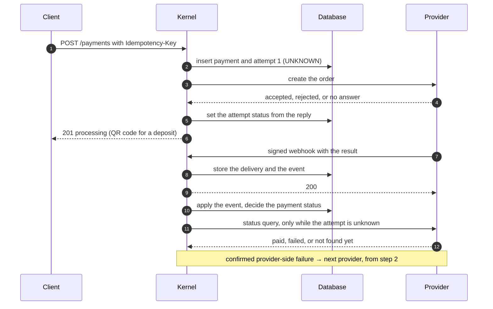
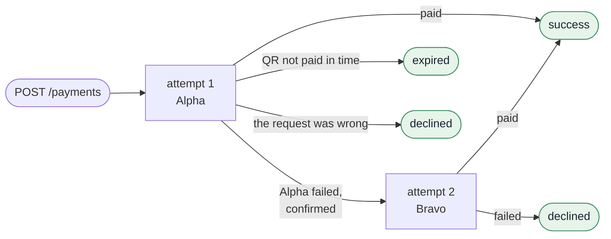
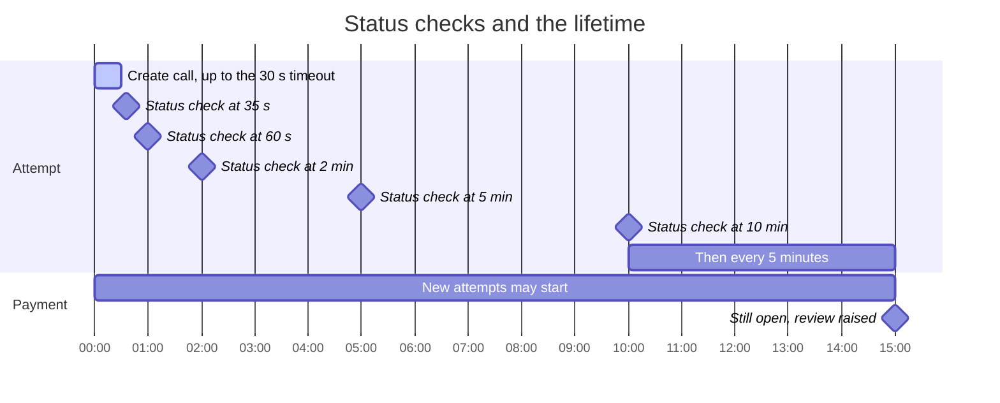
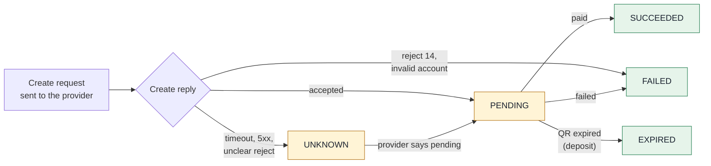

# Design

> **When the kernel does not know what a provider did, it says so, keeps asking, and finally
> hands the case to a person.** It never tries another provider on a guess.

The kernel takes a client's payment (a QR deposit or a bank payout) and drives it through one or
more providers until it has a result it can stand behind. A **payment** is the client's intent; an
**attempt** is one call to one provider. A payment has at most three attempts, each with a
different provider, and only one of them can be in flight at a time.

## The life of a payment



The provider is called between two short database transactions, never inside one. A slow
provider cannot hold a lock, and if the process dies mid-call the attempt is simply left
unknown: it is reconciled later, never sent again.

## How it decides

Every provider answer is read on two questions: **do we know the result**, and **would another
provider do better**?

| | The request was wrong | This provider failed |
|---|---|---|
| **Confirmed success** | success | success |
| **Confirmed failure** | declined, with the reason | try the next provider |
| **Unknown** | wait and ask | wait and ask |

- **Unknown is never treated as failure.** A timeout, a 5xx, an unfamiliar code or an unclear
  reject all mean "we don't know". Moving to another provider on a guess could pay twice.
- **Only the provider can confirm a failure**, by webhook or by answering a status query. An
  explicit reject on create is checked with a status query 35 seconds later, unless it says the
  account is invalid.
- **Moving to the next provider** happens only after a confirmed provider-side failure, within
  the 15-minute lifetime, when nothing is waiting for a person and no QR code has been shown to
  the client.
- **Asking, not hoping.** Unknown attempts are queried on a schedule that starts often and slows
  down. Whatever is still unknown when the lifetime ends goes to a review queue; the payment
  stays `processing` rather than pretending to be declined.
- **Late, repeated and out-of-order webhooks.** A repeat is recorded and not applied again. An
  open status never overwrites a final one. A success contradicted by a failure, or the reverse,
  keeps the first final status and raises review.

### Payment states

A payment stays `processing` while its attempts run, one at a time, and ends on a provider's
confirmed answer:



The IDR routes have two providers; a longer route adds attempt 3 the same way. An attempt still
unknown when the 15 minutes pass keeps the payment `processing` and raises review.

### Status checks and the lifetime

The clock of one attempt at a provider with a status query (Alpha). Bravo has none and waits
for webhooks:



### Attempt states

An attempt is one create request to one provider. Its status comes first from the create reply,
then from webhooks and status queries:



`UNKNOWN` and `PENDING` are open: only one open attempt per payment, and the sweep keeps asking.
An `UNKNOWN` attempt can also go straight to a final status when the first answer is final.
`SUCCEEDED`, `FAILED` and `EXPIRED` are final; a later report that contradicts them is kept and
raises review. A `FAILED` on the provider's side is what lets the payment try the next provider.

## Provider codes

Code tables are data in `alpha.tables.ts` and `bravo.tables.ts`, never a `switch`. On create, only
an invalid account is a clear result; every other reject is unknown until the provider confirms it.

| Alpha create reject | Deposit and withdrawal | Reason |
|---|---|---|
| 14 Invalid account | failed, client-side | the request is wrong; another provider would fail the same way |
| 51 Merchant limit exceeded | unknown | does not say whether the order exists at Alpha |
| 91 Issuer or switch inoperative | unknown | cannot tell whether the switch moved money |
| 96 System malfunction | unknown | a malfunction does not say the operation did not happen |
| any other code, timeout, 5xx | unknown | the brief: unknown |

The deposit and withdrawal maps are separate and currently hold the same classifications, the
conservative ones; a test asserts the withdrawal map is never less conservative.

| Bravo create response | Result |
|---|---|
| `202`, or `200` with `DUPLICATE_REFERENCE` | pending (the duplicate is the original payout) |
| `400 VALIDATION` on `beneficiary.account` | failed, client-side |
| any other `400`, `422`, 5xx, timeout | unknown |

A confirmed failure (a webhook or status `FAILED`) takes its cause from the code: Alpha 14 and
Bravo `ACCOUNT_CLOSED` / `INVALID_ACCOUNT` are client-side, every other code is provider-side, so
the next provider may be tried. Alpha's status endpoint answering 404 means "not found yet" at any
age: the attempt stays unknown and is asked again, and if the lifetime ends first it goes to
review. A 404 never moves a payout to the next provider.

Amounts are stored as integer minor units and formatted for each provider before every attempt:
Alpha `"150000.00"`, Bravo `15000000`.

## What it guarantees

- One payment per idempotency key; a retry with the same key replays the stored response, or
  answers 409 while the first request is still sending.
- Never two providers working on one payment at once, and never the same provider twice.
- A provider event changes state once, however many times it is delivered.
- A final status never changes.
- `declined` always means a provider confirmed it; an unresolved payment is never declined.
- Every webhook to a known connector, forged ones included, is stored exactly as received before
  it is answered.

These rules live in PostgreSQL constraints and a per-payment row lock rather than in process
memory, so they hold with any number of concurrent requests and workers. Each of the ten required
scenarios has a test named after it.

## Where to look

Everything lives in `src/modules/payments/`, layered from the outside in; the domain holds the
rules and no framework code, and dependency rules in `npm run verify` keep imports pointing inward:

```text
ui/http/                         HTTP: payments and webhooks controllers, request validation,
                                 webhook signature guard
application-services/
  payments/use-cases/            create and get a payment
  webhooks/use-cases/            verify and record an incoming webhook
  workers/use-cases/             the inbox that applies webhooks, the status sweep
  payment-orchestrator/          sends an attempt and applies what comes back
domain/                          the rules, no framework code
  payment/payment-decider.ts     what happens next: complete, decline, or next provider
  attempt/                       what each provider report does to an attempt
  sweep/                         when to ask a provider again
infrastructure/
  connectors/alpha, bravo/       each provider's wire format, codes and signatures
  persistence/                   tables, repositories and the payment lock
```

A good reading order: `create-payment.use-case.ts` → `payment-orchestrator.ts` →
`payment-decider.ts`, then `tests/e2e/scenarios.e2e-spec.ts` to see the ten scenarios end to end.
Decisions and their reasons are in `docs/adr/`.
